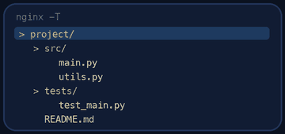
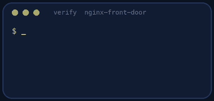

<p align="center"></p>

| | |
|-|-|
| **Time** | 60-75 min |
| **Cost** | free |
| **You need** | Your Ubuntu environment (WSL or OrbStack machine) with sudo |

## How this lab works

1. **Fork** this repository to your own GitHub account (button at the top right).
2. Clone **your fork** in your Ubuntu environment (WSL on Windows, your OrbStack machine on Mac).
3. Read the lab below (the same text is in [`LAB.md`](LAB.md)) and follow the mission.
4. Answer the questions in [`SUBMISSION.md`](SUBMISSION.md). Where a question asks for output, paste it in a code block. No screenshots needed.
5. Commit and push. Open the **Actions** tab of your fork (click *I understand my workflows, go ahead and enable them* the first time). The **Lab check** shows what is still missing.
6. When the check is green, **submit the URL of your fork** in the course platform.

> [!NOTE]
> The check only looks at your answers and any files the lab asks you to commit. Your instructor reads your work and may ask you to explain any line.

<p align="center"></p>

## 🎬 The situation

<p align="center"></p>

**Mission board - Launch Monday**

| Quest | Reward |
|-------|--------|
| Serve Clippy on port 80 | users stop typing `:8001` |
| One clean domain | `www.clippy.test` leads somewhere |
| `www` redirects to it | one address, not two |
| Two app servers | one can die and nobody notices |
| A friendly page if both die | no raw error |
| A bot-stopper | a rate limit, so a bot cannot flatten you |

Marketing launches Clippy on Monday with a campaign that will send real traffic. You will build the front door with Nginx, then test every promise by breaking things on purpose. A quest only counts if you can show it holds.

> [!IMPORTANT]
> **Your mission**
> - Put **Nginx** in front of two Clippy instances as a **reverse proxy** and load balancer
> - Add the redirect, the security headers and a **rate limit**
> - Break the backends on purpose and watch what users see
> - Read the logs like an operator

**Time:** 60-75 min | **Cost:** free | **You need:** your Ubuntu environment with `sudo`. `sudo ./teardown.sh` removes the lab.

<p align="center"></p>

## Part 0 - Set the scene

Fork this repository, clone your fork, and run:

```bash
sudo ./setup.sh
```

It installs Nginx and starts **two Clippy instances**: A on `127.0.0.1:8001` and B on `127.0.0.1:8002`. Each reports its own name in `/healthz`, so you can see who answered. It also maps `clippy.test` and `www.clippy.test` to your machine. Nginx is installed with **no site configured**.

<p align="center"></p>

## Part 1 - Recon

<p align="center"></p>

1. `curl localhost:8001/healthz` and `curl localhost:8002/healthz`. Which `version` does each return?
2. `curl -i http://clippy.test/healthz`. What do you get from Nginx today? Where does that page come from? (`ls /etc/nginx/sites-enabled/`, `sudo nginx -T | head -50`)
3. Look at the layout: `/etc/nginx/nginx.conf`, `sites-available/`, `sites-enabled/`, `conf.d/`. Which file is read first and which includes the others?
4. Where are the logs? (`ls /var/log/nginx`). Open a second terminal and run `sudo tail -f /var/log/nginx/access.log /var/log/nginx/error.log`. Leave it running.

> [!NOTE]
> **Think** Why put Nginx in front instead of exposing Clippy on port 80 directly? List three things Nginx can do that Clippy's own server should not.

<p align="center"></p>

## Part 2 - Build the front door

Write your configuration in `clippy.conf` (in this repo), then install it:

```bash
sudo cp clippy.conf /etc/nginx/sites-available/clippy
sudo ln -sf /etc/nginx/sites-available/clippy /etc/nginx/sites-enabled/clippy
sudo nginx -t && sudo systemctl reload nginx
```

Always run `nginx -t` **before** reloading. Build the file up in steps and test after each one.

| Step | What it must do | Directive hints |
|------|-----------------|-----------------|
| 1 | Send `clippy.test` to one Clippy instance | `server`, `server_name`, `location /`, `proxy_pass` |
| 2 | Tell the app who the real client is | `proxy_set_header Host`, `X-Real-IP`, `X-Forwarded-For` |
| 3 | Balance over **both** instances | `upstream` block with two `server` lines |
| 4 | Redirect `www.clippy.test` to `clippy.test` with a permanent redirect, keeping the path | a second `server` block, `return 301` |
| 5 | Add `X-Content-Type-Options: nosniff` and `X-Frame-Options`, and hide the Nginx version | `add_header ... always`, `server_tokens off` |

> [!NOTE]
> **Predict** After step 3, you send 10 requests to `/healthz`. Which instance answers each? Write down the pattern you expect, then run:
> `for i in $(seq 10); do curl -s http://clippy.test/healthz; echo; done`
> Save the output for your submission. What is the default balancing method?

> [!TIP]
> **Checkpoint** `curl -i http://www.clippy.test/stats` returns `301` with a `Location` header pointing at `http://clippy.test/stats`.

<p align="center"></p>

## Part 3 - Break it (three experiments)

### 3.1 One server dies

There is a helper script: `sudo /var/lib/clippy-lab/instance.sh stop a` (and `start a`).

> [!NOTE]
> **Predict** You stop instance A. What does a user see: an error on every second request, or nothing at all?

Run the 10-request loop again. Look at the Nginx **error log** while it happens. Which directives let Nginx notice and skip the dead server (`max_fails`, `fail_timeout`, `proxy_next_upstream`)? Tune them. Start A again afterwards.

### 3.2 Everything dies

Stop **both** instances and call the site. You get Nginx's default `502 Bad Gateway`. That is what your customers would see on launch day.

Create a friendly page (for example `/var/www/clippy-errors/maintenance.html`, any HTML with a clear message of at least a sentence) and wire it with `error_page 502 503 504` and an `internal` location. Test again. Start both instances.

### 3.3 The bot

A scraper hammers the site. Add a rate limit: `limit_req_zone` (5 requests per second per client IP) and `limit_req` with a `burst` in the `location`. Make rejected requests return **429**. Then flood it yourself:

```bash
for i in $(seq 60); do curl -s -o /dev/null -w '%{http_code}\n' http://clippy.test/healthz; done | sort | uniq -c
```

> [!NOTE]
> **Think** What does `burst` do and what does `nodelay` change? Why is 429 more honest than 503 for a rate limit?

<p align="center"></p>

## Part 4 - Investigate with the logs

1. In `access.log`, find your flood: how many 429 lines? What do the fields in each line mean (address, time, request, status, bytes, user agent)?
2. In `error.log`, find the exact line that appeared when instance A died. Copy it for your submission.
3. Count requests by status code from the log with `awk '{print $9}' /var/log/nginx/access.log | sort | uniq -c`.

<p align="center"></p>

## Part 5 - Prove it

<p align="center"></p>

```bash
sudo ./verify.sh
```

It stops your backends and floods your site on purpose to test the promises, then restores everything.

<p align="center"></p>

## Level up (optional)

- **Health-aware balancing.** Try `least_conn` and weights (`weight=3`). When is each useful?
- **Caching.** Add `proxy_cache` for `/stats` for 5 seconds. What do you gain, what could go wrong?
- **TLS.** Generate a self-signed certificate with `openssl` and add a `listen 443 ssl` server. Where would Let's Encrypt fit in a real deployment?

<!-- teardown:start (generated by labs.py, do not edit) -->
## Tear down (mandatory)

<p align="center"></p>

Resources left behind cost money, keep doors open and pollute the next lab. Removing what you created is part of the job, so it is part of the submission: **you must prove it is gone**.

Do this **last**, after you have pasted your `verify` output into `SUBMISSION.md` (once you tear down, the lab can no longer be verified).

1. Run `sudo ./teardown.sh`. It stops both Clippy instances and removes your site from Nginx, the error page, the `/etc/hosts` entries and the `clippy` user. (Nginx itself stays installed.)

Then run the proof:

```bash
sudo ./verify-teardown.sh
```

It prints a list of checks and must end with **TEARDOWN VERIFIED**. If it reports leftovers, remove them and run it again. Paste the full output in your submission.
<!-- teardown:end -->

<!-- submission:start (generated by labs.py, do not edit) -->
## 📬 Submission

Answer the questions in `SUBMISSION.md` in **your fork** (paste output in code blocks where asked), push, then submit the **URL of your fork**.

**Files to commit**

- `clippy.conf`: your Nginx site configuration, committed to the repo

**Questions to answer**

1. Paste the output of 10 requests to `/healthz` and explain how you know the load is being shared. What is the default balancing method and how would you change it?
2. You stopped one instance. Paste what the client saw and what the Nginx error log said. Which Nginx directives made failover possible?
3. You stopped both instances. What does the user see now, and why is a custom error page better than the default 502?
4. Explain what `limit_req` did when you flooded the site. Why is the status code 429 better than 503 here?
5. What is the difference between a forward proxy and a reverse proxy? Where does TLS termination usually happen and why?
6. Paste the output of `sudo ./verify.sh`. It must end with **ALL CHECKS PASSED**.
7. **Tear down.** Paste the output of `sudo ./verify-teardown.sh`. It must end with **TEARDOWN VERIFIED**.
<!-- submission:end -->
